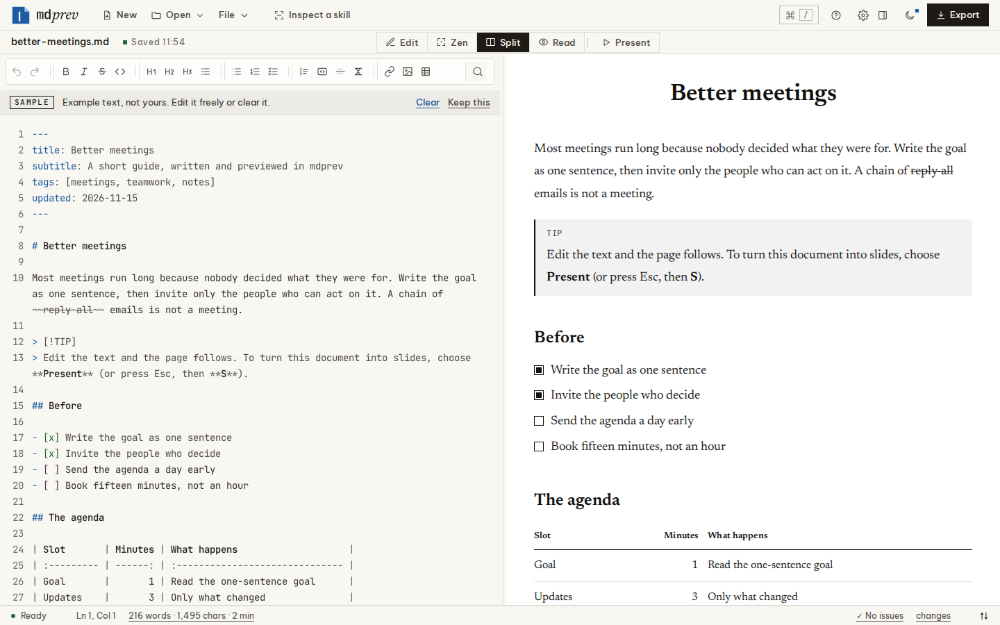
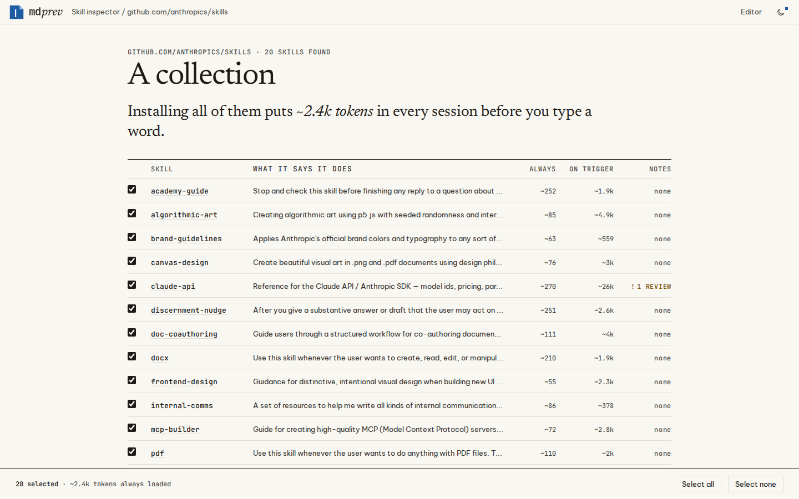

# mdprev

A quiet Markdown editor and an inspector for agent skills. Free, runs in your browser, nothing is uploaded, no account, no analytics.

[](https://github.com/aa1skillz/mdprev/actions/workflows/ci.yml) [](LICENSE)

**Live:** <https://mdprev.space> · [Features](https://mdprev.space/features/) · [Skill inspector](https://mdprev.space/skill-inspector/) · [Guides](https://mdprev.space/guides/)





## What it does

**Markdown editor**
- Live preview, Edit / Split / Read / Zen modes, slides with a presenter window.
- Export to PDF, Word (.docx), HTML, EPUB, LaTeX, TextPack and slides.
- Password-protected share links: encrypted on your device with AES-GCM, no server involved (expiry is soft).
- Turn a folder of notes with `[[wikilinks]]` into a static site with backlinks and link previews, built in the browser.
- Style Check (English), authorship marks, document themes, offline use (PWA).

**Skill inspector**
- Paste a GitHub link, a zip or a folder of agent skills (`SKILL.md` folders).
- Reports the specification check, the estimated token cost at three loading levels, broken references and scripts worth reading.
- It never runs a script. Token counts are estimates (characters divided by four).

What mdprev does not do: host files, sync, collaborate, or use AI. See [What mdprev does not do](https://mdprev.space/features/#not).

## Stack

Astro (static) + Preact + TypeScript strict. Markdown is rendered in a Web Worker (unified, remark, rehype, Shiki, KaTeX, Mermaid). Hand-written service worker; CSP generated at build time. Hosted on Cloudflare Pages.

## Develop

Requires Node 22.23.4 or newer and pnpm 10.

```sh
pnpm install
pnpm dev            # dev server
pnpm verify         # astro check + unit tests + production build
pnpm test:e2e       # Playwright (see playwright.config.ts)
```

`tools/` holds build helpers (service worker precache, CSP, brand and OG image generators, a static server that applies `_headers`).

## License

[MIT](LICENSE)
