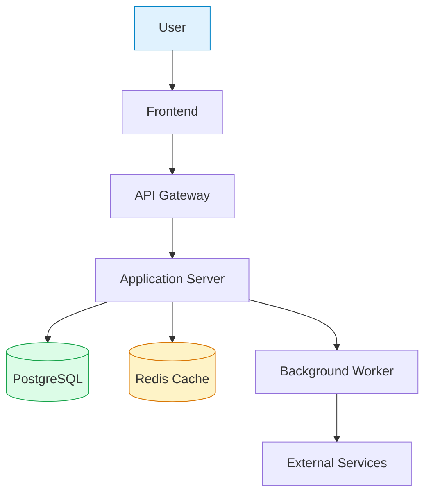
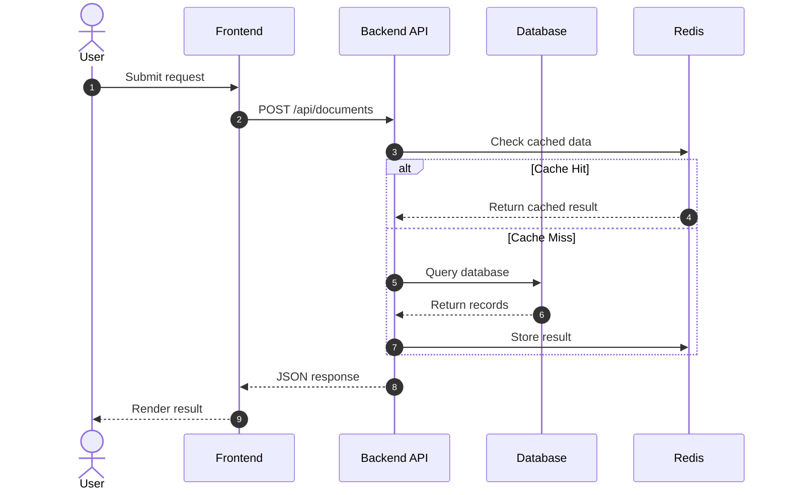
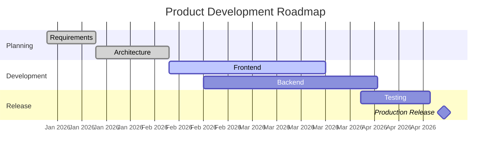
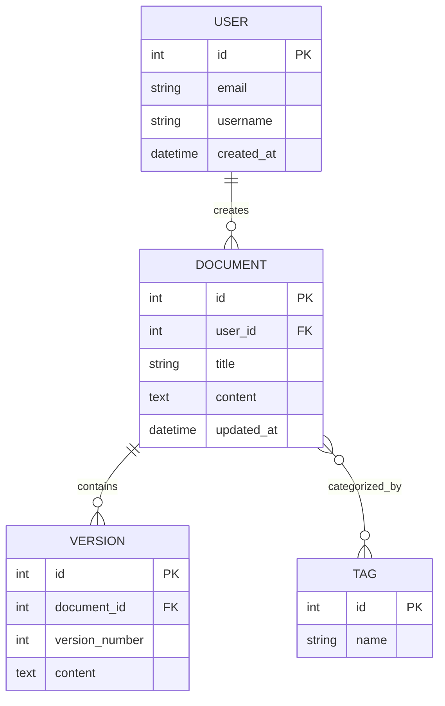

# The Architecture of Modern Software

> A practical exploration of software architecture, distributed systems, and engineering principles.

**Author:** Cris  
**Published:** November 20, 2026  
**Reading time:** 12 minutes

---

## 01. Introduction

Modern software engineering is not simply about writing code. It is about designing systems that are:

- **Scalable** — capable of handling increasing workloads.
- **Reliable** — consistently available and predictable.
- **Maintainable** — easy to understand, modify, and extend.
- **Observable** — transparent enough to diagnose problems.

The best architecture is not necessarily the most complex one. It is the simplest architecture that satisfies the actual requirements.

### A simple principle

> Any fool can write code that a computer can understand. Good programmers write code that humans can understand.

---

## 02. System Architecture

A typical web application consists of several independent layers.



### 2.1 Request lifecycle



### 2.2 Deployment timeline



### 2.3 Database relationship



---

## 03. Mathematical Expressions

Mathematics should render correctly in both inline and display modes.

### 3.1 Basic mathematics

Einstein's famous equation is \(E = mc^2\).

The quadratic formula:

\[
x = \frac{-b \pm \sqrt{b^2 - 4ac}}{2a}
\]

### 3.2 Calculus

Derivative:

\[
\frac{d}{dx}f(x) =
\lim_{h \to 0}
\frac{f(x+h)-f(x)}{h}
\]

Definite integral:

\[
\int_a^b f(x)\,dx = F(b)-F(a)
\]

### 3.3 Linear algebra

A matrix multiplication example:

\[
A =
\begin{bmatrix}
1 & 2 & 3 \\
4 & 5 & 6
\end{bmatrix}
\]

\[
B =
\begin{bmatrix}
7 & 8 \\
9 & 10 \\
11 & 12
\end{bmatrix}
\]

\[
AB =
\begin{bmatrix}
58 & 64 \\
139 & 154
\end{bmatrix}
\]

### 3.4 Advanced equation

The Gaussian probability density function:

\[
f(x) =
\frac{1}{\sigma\sqrt{2\pi}}
e^{-\frac{(x-\mu)^2}{2\sigma^2}}
\]

Bayes' theorem:

\[
P(A|B) =
\frac{P(B|A)P(A)}{P(B)}
\]

---

## 04. Data & Tables

### 4.1 Technology comparison

| Technology | Category | Primary Use | Learning Curve |
|:---|:---:|:---|---:|
| React | Frontend | UI Development | Medium |
| Astro | Framework | Content Websites | Low |
| Next.js | Framework | Full-stack Apps | High |
| PostgreSQL | Database | Relational Data | Medium |
| Redis | Database | Caching | Medium |
| Docker | DevOps | Containerization | Medium |

### 4.2 Financial performance

| Asset | Initial Value | Current Value | Return |
|---|---:|---:|---:|
| Bitcoin | $40,000 | $65,000 | +62.50% |
| Ethereum | $2,000 | $3,500 | +75.00% |
| NVIDIA | $100 | $145 | +45.00% |
| Cash | $10,000 | $10,000 | 0.00% |
| **Total** | **$52,100** | **$78,645** | **+50.95%** |

### 4.3 Long content table

| ID | Project | Owner | Status | Priority | Progress |
|---|---|---|---|---|---:|
| PRJ-001 | Documentation Platform | Alex | Completed | High | 100% |
| PRJ-002 | API Integration | Sarah | In Progress | Critical | 75% |
| PRJ-003 | Dashboard UI | David | In Progress | Medium | 60% |
| PRJ-004 | Authentication | Emily | Planned | High | 0% |
| PRJ-005 | Performance Audit | Chris | Blocked | Medium | 25% |
| PRJ-006 | Search Engine | Michael | Planned | Low | 0% |
| PRJ-007 | Export Module | Anna | In Progress | High | 40% |

---

## 05. Code Examples

### 5.1 TypeScript

```typescript
interface Document {
  id: string;
  title: string;
  content: string;
  updatedAt: Date;
}

function createDocument(
  title: string,
  content: string
): Document {
  return {
    id: crypto.randomUUID(),
    title,
    content,
    updatedAt: new Date(),
  };
}

const document = createDocument(
  "Getting Started",
  "Welcome to mdprev!"
);

console.log(document);
```

### 5.2 Python

```python
from dataclasses import dataclass
from typing import Optional

@dataclass
class User:
    id: int
    name: str
    email: str
    is_active: bool = True

def get_user(user_id: int) -> Optional[User]:
    users = {
        1: User(1, "Alice", "alice@example.com"),
        2: User(2, "Bob", "bob@example.com"),
    }

    return users.get(user_id)

user = get_user(1)

if user:
    print(f"Welcome, {user.name}!")
```

### 5.3 SQL

```sql
SELECT
    users.name,
    COUNT(documents.id) AS total_documents,
    MAX(documents.updated_at) AS last_activity
FROM users
LEFT JOIN documents
    ON documents.user_id = users.id
GROUP BY users.id, users.name
ORDER BY total_documents DESC
LIMIT 10;
```

### 5.4 Shell

```bash
# Install dependencies
pnpm install

# Start development server
pnpm dev

# Build production bundle
pnpm build

# Preview production build
pnpm preview
```

---

## 06. Lists & Task Management

### Development checklist

- [x] Define product requirements
- [x] Design application architecture
- [x] Implement Markdown parser
- [ ] Integrate Mermaid rendering
- [ ] Integrate KaTeX rendering
- [ ] Add document export
- [ ] Optimize mobile experience
- [ ] Release public beta

### Nested lists

1. **Frontend**
   - Component architecture
   - Responsive layouts
   - Theme management
     - Light mode
     - Dark mode
     - System preference

2. **Backend**
   - API architecture
   - Authentication
   - Database management

3. **Infrastructure**
   - CI/CD
   - Monitoring
   - Deployment

---

## 07. Blockquotes & Callouts

> Simplicity boils down to two steps:
>
> 1. Identify the essential.
> 2. Eliminate the rest.

**Note:** Markdown is designed to be readable even before it is rendered.

**Important:** Always validate user-generated Markdown before rendering embedded HTML.

**Warning:** Never execute arbitrary code inside a Markdown preview environment.

---

## 08. Links & Images

External resources:

- [Markdown Guide](https://www.markdownguide.org/)
- [Mermaid Documentation](https://mermaid.js.org/)
- [KaTeX Documentation](https://katex.org/)
- [GitHub Markdown](https://github.github.com/gfm/)

Image example:


---

## 09. Footnotes & Special Characters

Markdown supports footnotes in many extended dialects.[^1]

Another reference to the same footnote.[^1]

Special characters:

- Copyright: ©
- Registered: ®
- Trademark: ™
- Currency: € £ ¥ ₫ $
- Arrows: → ← ↑ ↓ ↔
- Mathematical: ∑ ∏ ∞ ≈ ≠ ≤ ≥

[^1]: This is an example of a Markdown footnote.

---

## 10. HTML & Formatting

Inline HTML:

<kbd>Ctrl</kbd> + <kbd>S</kbd>

<details>
<summary>Click to expand additional information</summary>

This is hidden content that can be expanded in compatible Markdown renderers.

- Additional detail one
- Additional detail two
- Additional detail three

</details>

Horizontal rule:

---

## 11. Final Thoughts

Great software is built through a combination of thoughtful architecture, careful implementation, and continuous improvement.

The goal is not to build the most complicated system.

The goal is to build something that works beautifully, remains understandable, and creates lasting value.

**Keep it simple. Keep it useful. Keep building.**

---

*End of document — mdprev rendering test.*
