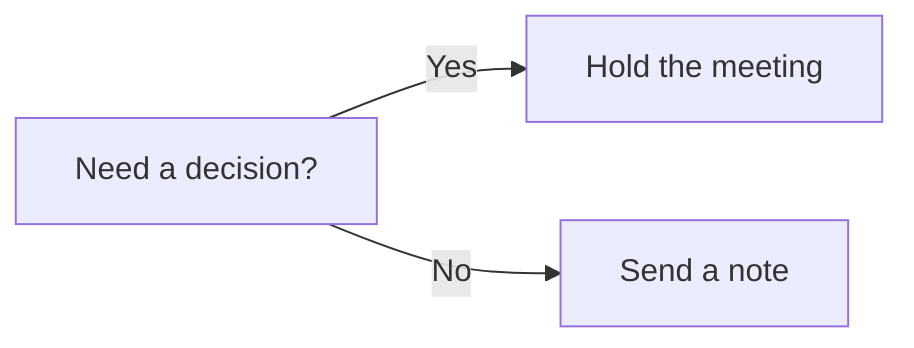

# Better meetings

Most meetings run long because nobody decided what they were for. Write the goal as one sentence, then invite only the people who can act on it. A chain of ~~reply-all~~ emails is not a meeting.

> [!TIP]
> Edit the text and the page follows. To turn this document into slides, choose **Present** (or press Esc, then **S**).

## Before

- [x] Write the goal as one sentence
- [x] Invite the people who decide
- [ ] Send the agenda a day early
- [ ] Book fifteen minutes, not an hour

## The agenda

| Slot       | Minutes | What happens                    |
| :--------- | ------: | :------------------------------ |
| Goal       |       1 | Read the one-sentence goal      |
| Updates    |       3 | Only what changed               |
| Decision   |       4 | Choose, or choose who chooses   |
| Next steps |       2 | Name an owner and a date        |

## Why it matters

A meeting costs the time of everyone in it:[^1]

$$
\text{cost} = n \times t \times r
$$

where $n$ people spend $t$ hours at an hourly rate $r$.

## When to skip it



## A template

```md
# Weekly sync

Goal: one sentence.
Decision: what we chose.
Next: owner, date.
```

[^1]: Six people for an hour at €50 each is €300, before anyone has said a word.
